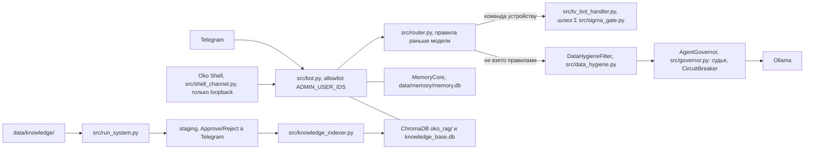

# Око — локальный ассистент на Ollama с Telegram-интерфейсом

Личный проект: ассистент, который целиком работает на домашнем ПК под Windows.
Генерация и эмбеддинги — через локальную Ollama, интерфейс — Telegram-бот,
память и база знаний — SQLite и ChromaDB. Ядро (диалог, судья, память, база
знаний) работает локально и облачных API не вызывает.

В облако ходят только опциональные модули — и только при явном включении:

- `src/smartthings_oauth.py` — токены SmartThings для наблюдения за техникой
  дома (`src/device_watch.py`). Включается переменной `OKO_SMARTTHINGS_TOKEN`
  в `.env` или файлом токенов `data/.smartthings_tokens.json` (путь меняет
  `OKO_ST_TOKENS`), который создаёт `python src/smartthings_oauth.py exchange`.
  Нет ни того, ни другого — наблюдение выключено, запросов в облако нет.
- `src/robo_cloud_inventory.py` — разовая опись устройств Roborock из аккаунта
  (только чтение). Бот его не загружает; запускается только вручную:
  `python src/robo_cloud_inventory.py --email <почта>` (нужен `python-roborock`).
- `src/garmin_sync.py` и `src/garmin_report.py` — суточные метрики Garmin Connect
  (сон, пульс, HRV, стресс, батарея тела, тренировки) из облака Garmin в локальную
  SQLite (`data/oko.db`, путь меняет `OKO_GARMIN_DB`) и сводки в Telegram в 08:00
  и 21:00. Включается только файлом токенов `data/.garmin_tokens.json` (путь меняет
  `OKO_GARMIN_TOKENS`), который создаёт разовый вход из консоли
  `python src/garmin_sync.py login` (почта и пароль — из `GARMIN_EMAIL` /
  `GARMIN_PASSWORD`, пароль не сохраняется; нужен `garminconnect`). Нет файла
  токенов — сводки не планируются, запросов в облако Garmin нет.
- `src/smartthings_probe.py` и `src/st_*.py` — ручные пробы облака SmartThings
  (опись устройств, программы и функции стиральной/сушильной машины Samsung).
  Бот их не загружает; запускаются только вручную из консоли с токеном
  `OKO_SMARTTHINGS_TOKEN` в окружении (`smartthings_probe.py` также читает
  `%LOCALAPPDATA%\oko\smartthings_token.txt`). Часть проб отправляет команды
  машине (`st_mode_walk.py`, `st_full_walk.py`, `st_option_probe.py`,
  `st_power_test.py`, `st_pause_test.py`; `st_name_walk.py` выбирает программу);
  `st_course_map.py` работает без сети, по сохранённому состоянию.

Проект однопользовательский: бот отвечает только ID из `ADMIN_USER_IDS`.

## Что умеет

- **Диалог с памятью.** Журнал переписки в `data/memory/memory.db`
  (ключ — локальный `subject_id`, а не Telegram ID). `/memory` — что хранится,
  `/forget` → `/forget confirm` — полное удаление.
- **База знаний с ручной модерацией.** Файл в `data/knowledge/` → карантин
  (`staging/`) → кнопки Approve/Reject в Telegram с проверкой хэша → индексация
  в SQLite и ChromaDB. `/discuss <файл>` — разговор по одному документу целиком;
  ответ целиком проходит того же судью в режиме «только блокировка» (без прохода коррекции).
  Ответ, который не помещается в окно судьи (в любом режиме), проверяется по кускам с нахлёстом:
  показывается только при PASS на каждом куске.
- **Судья ответов.** Каждый ответ проверяется вторым вызовом той же модели
  (`temperature=0`) по двум правилам из `src/manifesto.py`. FAIL → одна
  попытка коррекции, HALT → блокировка. Нераспознанный вердикт и
  неустранённое нарушение не отдаются пользователю.
- **Отказоустойчивость.** Транспортные сбои Ollama не запускают повторных
  вызовов модели (F1); предохранитель `CircuitBreaker` отклоняет запросы при
  массовых нарушениях; 15 служебных кодов `[ERR: …]` с фиксированным уровнем
  лога («светофор»), см. `docs/kernel_codes.txt`.
- **Боевой шлюз Σ для ТВ (`OKO_SIGMA_LIVE=1`).** Команда телевизору уходит только через шлюз. Пути мимо него
  (`/cam calib auto`, повтор пробуждения, мосты подсветки и звука, консольные утилиты ТВ) в этом режиме ничего не
  отправляют и отвечают «⏸ боевой Σ: действие мимо шлюза запрещено (…). Ничего не отправлено.». Если модуль шлюза
  не загрузился, команды ТВ не отправляются («Σ: команда не отправлена (модуль Σ не загружен)»), а `/status`
  первой строкой пишет «Σ: модуль не загружен, боевой режим = HALT».
- **Игровой режим.** `game_watcher.ps1` (v2): пока идёт игра из `games.txt`, бот
  продолжает работать (устройства, ТВ, Garmin, печать), а модели выгружаются из VRAM.
  Вопросы к модели в это время получают ответ-заглушку (`src/game_mode.py`, режим `sleep`);
  `/force_brain [минуты|off]` временно включает модель. `OKO_GAME_MODE=0` отключает режим.

## Архитектура



Службы Windows (NSSM, `setup_service.ps1`): `OkoBot` (`src/bot.py`) и `OkoWatcher` (`src/run_system.py`).
Подробная карта модулей и потоков — `docs/ARCHITECTURE.md`; правила безопасности и честные пробелы —
`docs/SECURITY.md`; архитектурные инварианты движка — `docs/INVARIANTS.md`; отдельные решения — `docs/ADR-*.md`;
история изменений — `CHANGELOG.md`.

## Требования

- Windows 10/11 (Linux-юниты в `deploy/` есть, но основной деплой — Windows + NSSM)
- Python 3.11+ (проверено на 3.12 и 3.13)
- [Ollama](https://ollama.com) с моделью генерации и моделью эмбеддингов
  (имена задаются в `.env`, умолчания — в `src/config.py` и `oko_rag/rag_config.py`)
- Для OCR в PDF: [Tesseract](https://github.com/tesseract-ocr/tesseract)
- Для служб Windows: [NSSM](https://nssm.cc)

## Установка

```powershell
git clone https://github.com/aleksejradomans-ai/OKO.git oko; cd oko
python -m venv .venv; .\.venv\Scripts\Activate.ps1
pip install -r requirements.txt -r oko_rag\requirements.txt
ollama pull gemma2
ollama pull bge-m3
Copy-Item .env.example .env      # заполнить TELEGRAM_TOKEN и ADMIN_USER_IDS
```

Запуск вручную (из корня репозитория):

```powershell
$env:PYTHONPATH = (Get-Location).Path
python src\bot.py          # бот
python src\run_system.py   # наблюдатель за data\knowledge
```

Как службы (PowerShell от администратора, `nssm.exe` в корне репозитория):

```powershell
.\setup_service.ps1 -PythonExe C:\path\to\python.exe
```

## Тесты

```powershell
python -m pytest src -q
```

Тесты не обращаются к Ollama и Telegram и не читают `.env`: `src/conftest.py`
подставляет временный `AI_BASE_DIR`, фиктивный токен и пустой список админов.
`test_enforce_compliance_live.py` и `scripts/` — ручные проверки на живой Ollama.

CI (GitHub Actions, `.github/workflows/pytest.yml`) — три проверки:

- `pytest-windows` (windows-latest) и `pytest-linux` (ubuntu-latest), Python 3.12: тот же набор `pytest src`
  плюс `test_data_hygiene.py`, `tools/test_calibrate_sigma.py`, `tools/test_check_sigma_2e.py`. Пропуски
  сверяются строго, по платформе: `.github/known_skips.txt` и `.github/known_skips_linux.txt` (на Linux
  дополнительно пропускаются только проверки прав доступа Windows); ожидаемые падения — `.github/known_xfail.txt`;
  лишний или пропавший пропуск — красный джоб.
- `control-map` — после обоих джобов: карта контроля `docs/control_map.csv` по отчётам JUnit **обеих** платформ
  (`tools/verify_control_map.py`) и сверка `docs/CONTROL_MAP.md` со свежей копией; код выхода не 0 — красный джоб.
  Итог виден в аннотации проверки: `both_platforms=yes|no EXIT=<n>`.

В каждом джобе `pytest-*` до тестов работают сторож ослабления тестов (база — последний опубликованный коммит
`oko-live`; правка охраняемых файлов без записи согласия — красный джоб) и мутационные проверки сторожа и реализации
красной зоны; подробности — `docs/SECURITY.md`, `docs/GUARDS.md`.

## Известные ограничения

- Судья — эвристика на той же малой модели; возможны ложные HALT/FAIL.
  Если судья сам упал не по транспорту (битый ответ Ollama), проверка повторяется один раз;
  при повторном сбое ответ не показывается (`[ERR: JUDGE_ERROR]`, статус `UNCHECKED`). Три таких
  сбоя подряд — состояние `JUDGE_DEGRADED` и одно сообщение об этом; при восстановлении — одно
  сообщение, что проверка снова работает.
- Длинный ответ судья проверяет по кускам: каждый кусок отдельно, без коррекции; блокировка или сбой на
  любом куске блокирует весь ответ. Ответ длиннее восьми кусков не показывается (`[ERR: JUDGE_TOO_LONG]`,
  без усечения). Противоречие между утверждениями из далёких друг от друга кусков судья при этом не видит.
- Индекс памяти пока `_NullIndex`: в контекст попадают только последние 10 сообщений.
- Весь ввод проходит через серверы Telegram до любых локальных фильтров.
- `Registry` — JSON-файл без межпроцессной блокировки (staging уже в SQLite).
- Модель склонна к непрошенным советам; судья их ловит не всегда.

## Лицензия

MIT, см. файл `LICENSE`.
