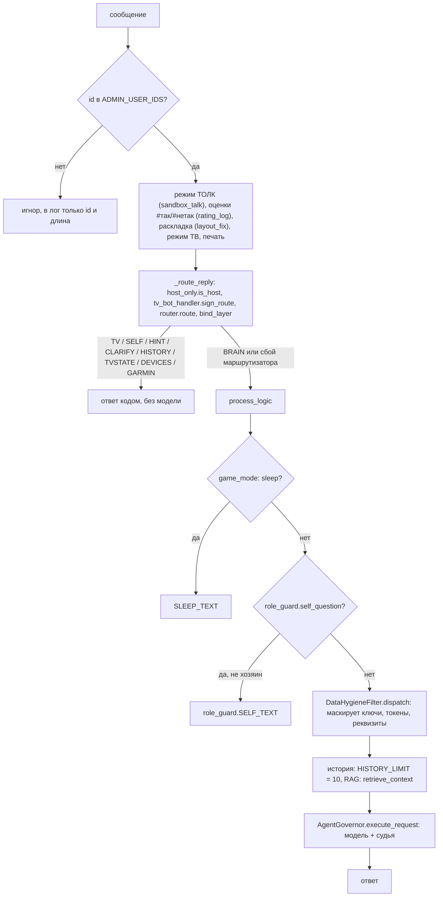
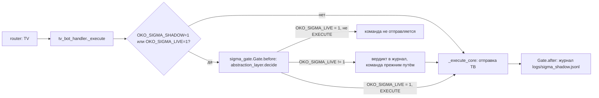
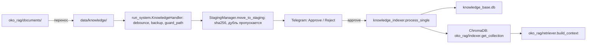
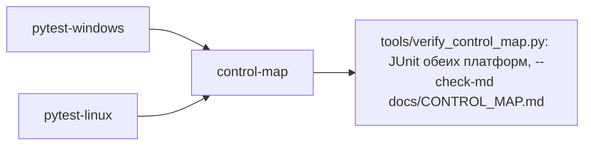

# Архитектура «Око»

Инженерная карта: процессы, модули, потоки данных и границы контуров. Каждое утверждение опирается на файл или
символ в репозитории. Правила, которые обязан сохранять любой код, — `docs/INVARIANTS.md`; внешние контуры и
хранилища данных — `docs/SECURITY_AND_DATA.md`; правила безопасности и пробелы — `docs/SECURITY.md`.

## 1. Процессы и точки входа

| процесс | точка входа | что делает | как запускается |
|---|---|---|---|
| Бот | `src/bot.py` | Telegram-бот: маршрутизация, вызов модели, память, кнопки карантина документов | фоновый процесс; способ установки в Windows — `setup_service.ps1`; Linux — юнит в `deploy/` |
| Наблюдатель | `src/run_system.py` | следит за `data/knowledge/`, ставит файлы в карантин (staging) | фоновый процесс; Linux — юнит в `deploy/` |
| Сторож здоровья | `src/process_watchdog.py` | heartbeat, доля строк ERROR/CRITICAL в логе, потолок памяти целевого процесса | Linux — юниты сторожей в `deploy/` |
| Игровой режим | `game_watcher.ps1` | пока идёт игра из `games.txt`, пишет `game_mode.flag` и выгружает модели из VRAM | способ запуска в репозитории не описан |
| Управление службами | `oko-ctl.ps1` | `start` / `stop` / `restart` / `status` / `logs` (порядок: Ollama, наблюдатель, бот) | вручную |
| Окно на ПК (Oko Shell) | `src/shell_channel.py` | TCP только на loopback-адресе (константа `HOST`, порт `OKO_SHELL_PORT`, по умолчанию 47321), ключ `OKO_SHELL_KEY`; пустой ключ — канал выключен | внутри процесса бота |
| Служебные скрипты | `tools/*.py`, `tools/*.ps1` | ручные проверки, калибровка Σ, уведомления, карта контроля | вручную или в CI |

## 2. Поток текстового сообщения

Порядок проверок — `src/bot.py::handle_message` и `src/bot.py::_route_reply`. Канал Oko Shell передаёт текст тем же
обработчикам (`src/shell_channel.py`), своего маршрута и своего вызова модели у него нет.

- `DataHygieneFilter` не блокирует: `dispatch` всегда возвращает `is_allowed=True` (`src/data_hygiene.py`), поэтому
  ветка `[BLOCKED: …]` в `process_logic` с этим фильтром не срабатывает.
- Сбой внутри `_route_reply` пишет в лог `ROUTE_ERROR` и отдаёт текст модели (`return None`), а не устройству.
- `router.route` в игровом режиме вызывается без модели смысла (`intent=None`), иначе — с `router.default_intent`.
- Хозяин (`src/host_only.py::is_host`, только по id из окружения): вопрос о себе идёт к модели, а не к шаблону;
  сторожа выхода при этом действуют (`process_logic`, ветка `[HOST_ONLY]`).

## 3. Модель и судья (`src/governor.py`)

- Судья — второй вызов модели с `DETERMINISTIC_OPTIONS = {"temperature": 0, "seed": 0}` по правилам
  `POL_001` / `POL_002` из `src/manifesto.py`; допустимые вердикты — `PASS`, `FAIL:POL_001`, `HALT:POL_002`
  (`docs/kernel_codes.txt`).
- Длинный ответ проверяется кусками с нахлёстом `JUDGE_CHUNK_OVERLAP_PCT = 10`; кусков не больше
  `JUDGE_CHUNK_MAX` (по умолчанию 8, переменная `OKO_JUDGE_CHUNK_MAX`, `src/config.py`); больше — `JUDGE_TOO_LONG`.
- Предохранитель качества — `CircuitBreaker(error_threshold=0.5, min_sample=10, cooldown_s=PROBE_COOLDOWN_S)`,
  `PROBE_COOLDOWN_S = 60.0`; предохранитель связи с Ollama — отдельный `TransportGate` (`src/transport_gate.py`).
- Служебные коды — единый реестр `YELLOW_CODES` (8), `RED_CODES` (5), `SPLIT_CODES` (1); маркер `[ERR: КОД]`
  выдаётся только через `log_service_code`, уровень лога берётся из реестра. Мимо судьи проходит только текст,
  целиком равный одному известному маркеру (`is_service_marker`).

## 4. Контур A — команды устройствам

- Ядро решений — `src/abstraction_layer.py` (`decide`, `guarded_decide`, `DissonanceIntegrator`); шлюз —
  `src/sigma_gate.py` (`Gate.before`, `Gate.after`, `Gate.probe`, `live_enabled`).
- Без `OKO_SIGMA_SHADOW=1` и без `OKO_SIGMA_LIVE=1` шлюз не вызывается вовсе (`src/tv_bot_handler.py::_execute`).
- Путь журнала — `OKO_SIGMA_SHADOW_PATH` или `logs/sigma_shadow.jsonl` (`SHADOW_DEFAULT_PATH`).
- Знаковые команды «+N» / «−N» разбирает `tv_bot_handler.sign_route` до маршрутизатора; потолок громкости —
  `src/tv_commands.py::SIGN_VOLUME_MAX`.
- Связки «фраза → штатная команда» — `src/bind_layer.py` поверх правил, хранение — `src/oko/memory/`.

## 5. База знаний

- Отслеживаемые расширения: `.txt .py .js .sql .pdf .docx .xlsx` (`src/run_system.py::WATCHED_EXTENSIONS`).
- Резервные копии — `backups/` в каталоге данных, не больше `MAX_BACKUPS_PER_FILE` (по умолчанию 50) на файл.
- Очередь карантина — SQLite через `src/staging_repository.py` (`StagingRepository.setup_database`).
- При старте наблюдатель ставит в очередь файлы, уже лежащие в `data/knowledge/` (`_schedule_existing`).

## 6. Выход в интернет

`src/net_gateway.py` — единственный шлюз GET-запросов: открыт только при `OKO_NET_OPEN=1` и отсутствии файла
`<data>/net/KILL`, только `https`, хост и путь — из `config/net_allowlist.json`. Вызывается из `tools/net_fetch.py`.
Облачные модули (SmartThings, Garmin, Roborock, Midea) и Telegram ходят в сеть мимо шлюза; полный список —
`docs/SECURITY_AND_DATA.md`, раздел 1.

## 7. CI и карта контроля

- Каждый джоб `pytest-*`: сторож ослабления тестов (`tools/weakening_guard.py --base HEAD~1`), `pytest src`,
  тесты вне `src/` (`test_data_hygiene.py`, `tools/test_calibrate_sigma.py`, `tools/test_check_sigma_2e.py`),
  сверка xfail и пропусков со списками `.github/known_*.txt`, карта контроля по отчётам своей платформы.
- Job `control-map` (`needs: [pytest-windows, pytest-linux]`, `if: always()`) скачивает артефакты
  `pytest-reports-windows` и `pytest-reports-linux`, запускает верификатор по четырём отчётам JUnit и сверяет
  `docs/CONTROL_MAP.md` со свежей копией; код выхода верификатора становится кодом шага. Итог —
  аннотация `both_platforms=yes|no EXIT=<n>`, отчёты — артефакт `control-map` (7 дней).
- Источник карты — `docs/control_map.csv` (+ `docs/control_map_plain.csv`); `docs/CONTROL_MAP.md` генерируется
  верификатором и руками не правится. Тесты верификатора на настоящей карте используют фикстуру
  `src/control_map_junit/{windows,linux}.xml` (`src/test_verify_control_map.py`).
